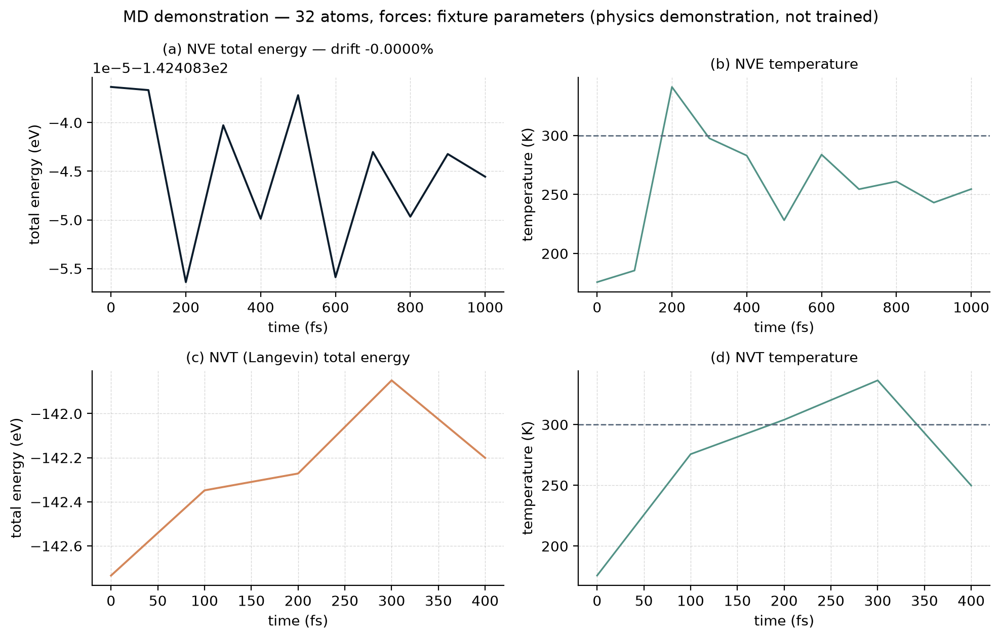

<div align="center">

# ⚛️ Atomistic PINN Lab

**A research-grade, verification-first reproduction of the physically informed
neural network (PINN) bond-order potential for aluminum**

*G. P. Purja Pun, R. Batra, R. Ramprasad & Y. Mishin —
**Nature Communications 10**, 2339 (2019)*

[-0B1C2C)](https://doi.org/10.1038/s41467-019-10343-5)
[](.github/workflows/tests.yml)
[](https://github.com/hoseinrza/Atomistic-Intelligence-Lab/actions/workflows/tests.yml)
[](#installation)
[](#testing)
[](#testing)
[](LICENSE)
[](#-fidelity-notice)

A small neural network maps 60 local descriptors to the **eight parameters of an
analytical bond-order potential** — so extrapolation stays physics-guided:

```
        G_i → p_i → E_i          (this work: physics in the loop)
   not  G_i → E_i                (conventional NN potential: pure regression)
```

</div>

---

## ✨ Highlights

- **Every equation of the paper's Methods section implemented** (Eqs. 3–13) and
  verified against closed forms, `scipy`/`ASE`, and two independently
  implemented methods that must agree.
- The BOP physics layer matches an **independently written reference
  transcription at rtol 1e-9** across five structure types — that test caught a
  real bug (an `a` instead of `a²` in Eq. 8) before any result existed.
- **Full-pipeline finite-difference vs autograd forces agree to 7.6e-8 eV/Å**
  (two independent derivative routes over the complete
  positions → descriptors → network → BOP chain).
- **206 automated tests** in three pytest classes (unit / integration /
  scientific_validation) plus `ruff` and `mypy` gates on every commit;
  reference values are never fabricated.
- **Seeded molecular dynamics**: NVE energy-drift gate (committed 32-atom
  example: **6.5e-8 relative drift over 1 ps**), bit-exactly reproducible
  Langevin NVT, and an extrapolation guard on every logged frame.

## 📋 Reproduction scope

<table>
<tr><th>Paper element</th><th>Reference</th><th>Status</th></tr>
<tr><td>Unit conventions &amp; data contracts</td><td>—</td><td>✅ Sprint 0</td></tr>
<tr><td>60-dim Legendre/Gaussian descriptors (Eqs. 3–5)</td><td>Methods</td><td>✅ Sprint 1</td></tr>
<tr><td>Neighbor lists / full-PBC geometry</td><td>Methods</td><td>✅ Sprint 1</td></tr>
<tr><td>Analytical BOP, 8 NN-predicted parameters (Eqs. 6–12)</td><td>Methods</td><td>✅ Sprint 2</td></tr>
<tr><td>PINN 60×15×15×8 + NN baseline 60×16×16×1</td><td>Table 1</td><td>✅ Sprint 3</td></tr>
<tr><td>DFP optimization + seeded restarts + Eq. (13) objective</td><td>Methods</td><td>✅ Sprint 3 (real-data dev run: baseline done)</td></tr>
<tr><td>10-fold cross-validation driver</td><td>Methods</td><td>✅ Sprint 4 machinery (full run scheduled)</td></tr>
<tr><td>Finite-difference forces (post-training only) + autograd cross-check</td><td>Methods</td><td>✅ Sprint 4</td></tr>
<tr><td>ASE calculator + seeded NVE/NVT MD</td><td>—</td><td>✅ Sprint 4 (500-atom demo awaits trained checkpoint)</td></tr>
</table>

> **Explicitly not done — by methodology, not omission:** forces are never a
> training or validation target; DFP is never silently replaced by Adam/L-BFGS;
> every value the paper leaves unspecified is flagged in the uncertainty ledger
> ([docs/equations.md](docs/equations.md) §7), never invented.

## ⚠️ Fidelity notice

The paper's DFT database (3,649 training supercells / 127,592 atoms;
26,425 testing supercells) is **not publicly downloadable** — only via the
Supplementary Information tables or on request. Until it is obtained, all
training results are **methodological reproductions on documented alternative
data** (public ANI-Al, Smith et al., Nat. Commun. 12, 92 (2021)), never exact
reproductions. The pipeline itself is validated on a **labeled synthetic
database** — pipeline validation only. Details:
[data/README.md](data/README.md) ·
[docs/reproduction_protocol.md](docs/reproduction_protocol.md).

## 📈 Results so far

<table>
<tr><th>Model</th><th>RMSE (meV/atom)</th><th>MAE (meV/atom)</th><th>Data</th><th>Status</th></tr>
<tr><td>Baseline NN 60×16×16×1 (ours)</td><td><b>4.32</b></td><td>3.19</td><td>16-structure ANI-Al dev subset</td><td>✅ done (dev budget)</td></tr>
<tr><td>PINN 60×15×15×8 (ours)</td><td>—</td><td>—</td><td>same subset</td><td>⏳ tuning chain scheduled</td></tr>
<tr><td>Paper reference band</td><td colspan="4" align="center">3–4 meV/atom — a reference <i>band</i>, not a pass/fail gate, for alternative data</td></tr>
</table>

Scheduled tuning chain (owner-approved 2026-11-22): documented **γ sweep**
(3 × 50 iterations) → **five-restart final run** at the best γ (ledger §7.7) →
**full 10-fold cross-validation** — ≈ 1,650 DFP iterations in total, seeded and
provenance-logged.

## ⚙️ Installation

```bash
git clone https://github.com/hoseinrza/Atomistic-Intelligence-Lab.git
cd Atomistic-Intelligence-Lab
python3 -m venv .venv && source .venv/bin/activate
# CPU-only torch is sufficient (the paper itself trained on CPUs):
pip install torch --index-url https://download.pytorch.org/whl/cpu
pip install -e ".[dev]"
```

## 🚀 Usage

```bash
atomistic-pinn version    # package version
atomistic-pinn paper      # paper constants pinned in this project

# train from one config (resolves ledger decisions, writes a
# provenance-complete checkpoint + report under results/):
atomistic-pinn train --config configs/pinn_al_ani.yaml

# evaluate a trained checkpoint on its config's dataset:
atomistic-pinn evaluate --checkpoint checkpoints/baseline_nn_ani_dev.pt \
                        --config configs/baseline_nn_ani.yaml

# 10-fold cross-validation protocol from one config:
atomistic-pinn benchmark --config configs/cross_validation.yaml
```

<details>
<summary><b>🗂 Project layout</b> (click to expand)</summary>

```text
├── AGENTS.md         working conventions (commit discipline, fidelity rules)
├── configs/          experiment configurations (paper facts + labeled decisions)
├── data/             no datasets in git; see data/README.md
├── docs/             scientific method, equations, architecture, sprint records
├── src/atomistic_pinn/
│   ├── constants.py  units + physical + paper-derived constants
│   ├── exceptions.py error hierarchy
│   ├── cli.py        Typer CLI (version, paper, train, evaluate, benchmark)
│   ├── data/         schema (data contracts) + ANI-Al loaders
│   ├── geometry/     neighbor lists (full PBC image enumeration) + angles
│   ├── descriptors/  cutoff, radial Gaussians, Legendre, 60-dim builder
│   ├── physics/      BOP engine (Eqs. 6–12, torch) + FD/autograd forces
│   ├── models/       PINN 60×15×15×8 and baseline NN 60×16×16×1 (Table 1)
│   ├── training/     Eq. (13) objective, DFP, fixed-BOP pre-fit, trainer,
│   │                 provenance checkpoints, config validation, synthetic DB
│   ├── evaluation/   energy/force metrics, folds, 10-fold CV driver
│   ├── simulation/   ASE calculator + seeded NVE/NVT MD runners
│   └── reporting/    training reports (metrics + figures)
├── tests/
│   ├── unit/                 constants, schema, cutoff/Legendre, DFP, models
│   ├── integration/          ASE ↔ schema, neighbor lists, CLI runs
│   └── scientific_validation/ paper facts, invariances, closed forms,
│                              independent references, training gates
├── examples/md_demo/ committed labeled MD demonstration
└── .github/workflows/tests.yml
```

Full module map and dependency rules:
[docs/architecture.md](docs/architecture.md).

</details>

## 📚 Documentation

| Document | Content |
| --- | --- |
| [docs/equations.md](docs/equations.md) | all paper equations transcribed + the uncertainty ledger (§7) |
| [docs/scientific_method.md](docs/scientific_method.md) | why the method works, component by component |
| [docs/architecture.md](docs/architecture.md) | layers, module map, dependency rules, testing strategy |
| [docs/data_format.md](docs/data_format.md) | data contracts, units, energy conventions, leakage rules |
| [docs/reproduction_protocol.md](docs/reproduction_protocol.md) | fidelity levels, dataset plan, target metrics, reporting rules |
| [docs/dataset_composition.md](docs/dataset_composition.md) | transcribed + verified composition of the paper's DFT database (SI Tables 1–3) |
| [docs/md_plan.md](docs/md_plan.md) | molecular dynamics plan: force route, protocol, validation |
| [docs/sprint0.md](docs/sprint0.md) … [docs/sprint4.md](docs/sprint4.md) | one document per sprint: delivered records + live plans |

## 🧊 Molecular dynamics demonstration

The potential plugs into ASE (`atoms.get_potential_energy()` /
`atoms.get_forces()`) and runs seeded NVE/NVT trajectories
([docs/md_plan.md](docs/md_plan.md)). A small labeled demonstration — 32-atom
FCC Al, seeded NVE + Langevin NVT with **fixture parameters** (a physics
demonstration, *not* a trained potential) — is committed under
[examples/md_demo/](examples/md_demo/):

| File | Content |
| --- | --- |
| [nve_trajectory.extxyz](examples/md_demo/nve_trajectory.extxyz) | NVE trajectory frames (openable in OVITO/ASE) |
| [nvt_trajectory.extxyz](examples/md_demo/nvt_trajectory.extxyz) | seeded Langevin NVT trajectory frames |
| [energy_temperature.csv](examples/md_demo/energy_temperature.csv) | per-frame energy / temperature / neighbor record |
| [md_demo.png](examples/md_demo/md_demo.png) | four-panel energy and temperature figure |
| [summary.json](examples/md_demo/summary.json) | provenance (NVE drift −6.5e-8 relative, seeds, force source) |



Reproduce it — with a trained checkpoint for the real potential:

```bash
python experiments/run_md_demo.py --checkpoint checkpoints/pinn_al_ani_dev.pt
python experiments/run_md_demo.py --fixture --conventional-cells 2 --nve-steps 1000 --nvt-steps 400
```

## 🧪 Testing

```bash
pytest                        # everything
pytest -m unit                # fast subset
pytest -m scientific_validation
```

Physical constants are verified against `scipy.constants`; the recorded paper
facts (parameter counts 1283/1265, the +0.38446 eV/atom shift, dataset sizes)
are re-derived by independent arithmetic; descriptors, forces and the physics
layer are checked against closed forms and independent references. Reference
values are never fabricated.

## 📣 Citation

See [CITATION.cff](CITATION.cff) — please cite the original paper (and this
repository) if you use this software. Zenodo deposition metadata is prepared
([.zenodo.json](.zenodo.json)) for archival.

## 📄 License

[MIT](LICENSE). The reproduced methodology is from the open-access paper
(CC BY 4.0).
